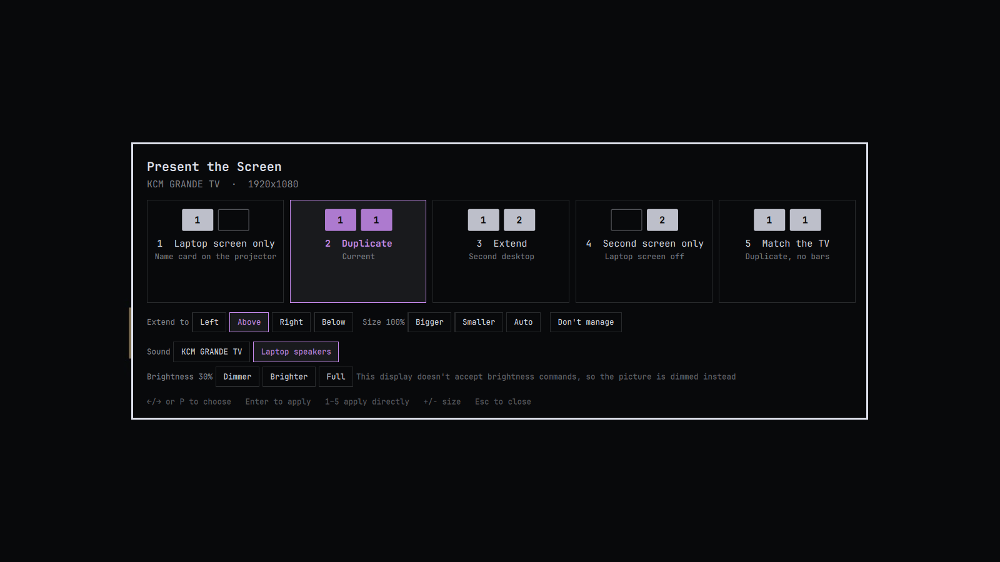
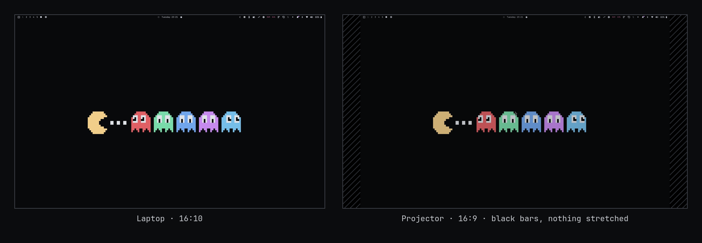
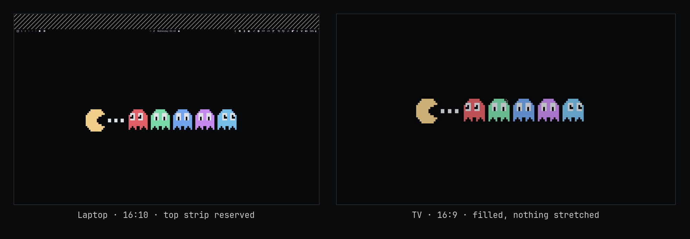
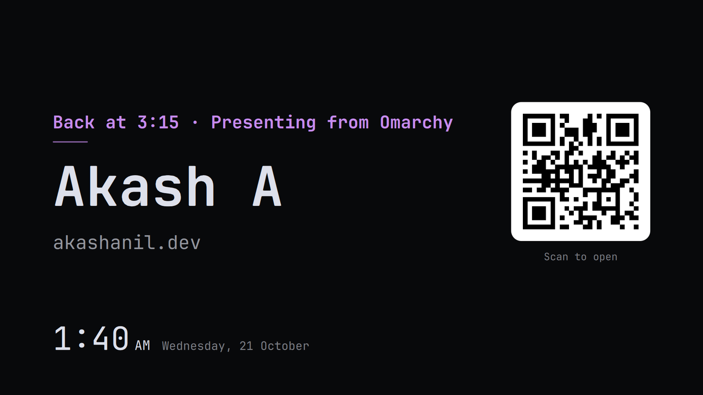

# Present the Screen

Windows-style projector modes for [Omarchy](https://omarchy.org). Plug in a
projector or TV, press `SUPER + P`, pick a mode. Present the Screen ("Present"
below) also picks where the sound goes, dims a TV that's too bright, and shows
the current mode in the bar.



| Mode | What you get |
|---|---|
| **1 Laptop screen only** | The external display shows a card: your name, site, a QR code and the time. |
| **2 Duplicate** | The external shows your laptop screen, scaled to fit with black bars. Nothing is stretched, and neither screen changes resolution. |
| **3 Extend** | A second desktop to the left, right, above or below. |
| **4 Second screen only** | The laptop screen is turned off. |
| **5 Match the TV** | Like Duplicate, but no black bars: the laptop's desktop shrinks to the TV's shape, flush with the bottom of the screen, and exactly that part fills the TV. |

## Why

Presenting from Hyprland usually goes wrong in two ways:

- **Mirroring stretches.** Hyprland's `mirror` copies your laptop's pixels onto
  the other display as they are, so a 16:10 laptop on a 16:9 projector comes out
  squashed. Present's Duplicate keeps each display at its own native resolution
  and letterboxes your screen instead, the way Windows does.
- **Text is tiny or huge.** A catch-all monitor rule gives every new display the
  same scale, and Hyprland's `auto` scale guesses from the physical size the
  display reports, which TVs and projectors often get wrong. Present scales every
  display so it looks like a 1080p screen: 4K → 2, 1440p → 1.33, 1080p or lower → 1.



## What happens when you plug in

- **A display seen before** gets its saved mode, position and size back.
- **A new display** starts in Duplicate and the picker opens.
- **Unplugging** returns everything to the laptop screen, including turning it
  back on after Second screen only.
- **Closing the lid** in Duplicate makes the external your main screen; opening
  it goes back to Duplicate.

While Duplicate is on, the system doesn't idle, lock or sleep on its own, so a
talk isn't interrupted. `SUPER + L` still locks, and the projector then shows
the lock screen rather than your desktop.

A display whose native mode is below 50Hz (a TV's 4K@30, for example) is driven
at its largest mode of 50Hz or more instead.

## Install

```bash
omarchy plugin add https://github.com/akashanil-dev/omarchy-present.git --enable
sudo pacman -S wl-mirror            # Duplicate and Match the TV
sudo pacman -S qrencode ddcutil     # optional: the card's QR code, monitor brightness
```

`--enable` asks where in the bar the icon goes; the right section suits it.

Then bind the picker to a key in `~/.config/hypr/bindings.lua`. Present doesn't
add the binding for you. `SUPER + P` matches Windows; Omarchy uses it for
"Pseudo window", which only does something in the dwindle layout:

```lua
hl.unbind("SUPER + P")
o.bind("SUPER + P", "Project to a second screen", "omarchy-shell shell toggle io.github.akashanil-dev.present")
```

### Updating from 1.0.0

```bash
omarchy plugin update io.github.akashanil-dev.present
omarchy plugin disable io.github.akashanil-dev.present
omarchy plugin enable io.github.akashanil-dev.present --section right
```

1.0.0 had no bar icon, so Omarchy recorded it as a plugin without one;
disabling and enabling it again puts the new icon in the bar. Your saved
displays are kept.

## Using it

`SUPER + P` opens the picker.

| Key | Action |
|---|---|
| `←` `→`, or `P` | Choose a mode |
| `Enter` | Apply it |
| `1`–`5` | Apply a mode directly |
| `+` `−` | Bigger or smaller (Extend and Second screen only) |
| `0` | Back to the automatic size |
| `Esc` | Close |

Below the modes: where an extended display sits and how big things are on it,
which output the sound plays from, and the display's brightness. **Don't
manage** hands the display back to your own Hyprland config, for a desk monitor
you have already set up in `monitors.lua`.

Everything is also available from a terminal:

```bash
P=~/.config/omarchy/plugins/io.github.akashanil-dev.present/bin/present
$P status                       # JSON: the display and its saved mode
$P set duplicate                # duplicate | match | extend | external | internal | ignore
$P position up                  # right | left | up | down
$P scale up                     # up | down | reset
$P title "Back at 3:15"         # top line of the card; no text clears it
```

### Match the TV



The laptop panel keeps its native resolution (laptop panels take no other), but
a strip at the top is reserved so the desktop below it has the TV's shape: on a
16:10 laptop and a 16:9 TV, about a tenth of the height. Your bar sits in that
strip, so it doesn't show on the TV. A window that goes fullscreen is held
inside the shaped area, while the app still behaves as fullscreen, so slides
fill the TV. Choosing another mode or unplugging gives the laptop its full
height back. With a projector that is narrower than the laptop (4:3), Match
the TV works like Duplicate.

### Sound

The picker lists every sound output that is plugged in, named after the
display for HDMI, with the one playing now highlighted. Choose one to switch to
it; on laptops whose speakers and headphone jack are separate profiles,
Present switches the profile too. The choice is remembered for that display
and put back when it is plugged in again. Unplugging still sends the sound back
to the laptop, since the display it was going to is gone.

```bash
$P audio                        # outputs as JSON
$P audio set '<id from the list>'
```

### Brightness

**Dimmer**, **Brighter** and **Full** in the picker, or scrolling over the bar
icon, change the external display's brightness in steps of 10%. A monitor that
accepts DDC/CI commands has its own backlight changed, with
[`ddcutil`](https://archlinux.org/packages/extra/x86_64/ddcutil/). Most TVs
don't; for them the picker says so and Present darkens the picture with a
black layer instead, down to 20%. Clicks go through it, and blacks turn a
little grey since the backlight stays as bright.

```bash
$P brightness down              # up | down | reset
```

### Bar icon

While an external display is connected, an icon in the bar shows the mode.
Hover for the mode, display, sound output and brightness; click for the
picker; scroll for brightness. Add it with
`omarchy plugin enable io.github.akashanil-dev.present --section right`, or
move it like any other bar widget.

### The card



In **Laptop screen only** the projector keeps its signal and shows a card in
your theme's colours, instead of being switched off. Some TVs drop off HDMI when
their signal stops and stay gone until power-cycled; this way they never do,
and switching back is instant. Set it up in
`~/.config/io.github.akashanil-dev.present/card.json`:

```json
{
  "name": "Your Name",
  "site": "example.dev",
  "title": "",
  "clock": true
}
```

| Key | Shows |
|---|---|
| `title` | A line above your name, for the room: "Back at 3:15", the talk's title |
| `name` | Your name, large |
| `site` | Under your name, and as a QR code to `https://` that site |
| `qr` | A different link for the QR code; `""` for none |
| `clock` | The time and date in the corner (`false` to hide) |

Changes show up right away. Without a `card.json`, the card is a large clock.
The QR code needs [`qrencode`](https://archlinux.org/packages/extra/x86_64/qrencode/);
without it the card has no code. Everything drifts a few pixels each minute, so
nothing burns into a TV left on all day.

## How it works

- **No config files are edited.** Display rules are applied at runtime with
  `hyprctl eval`, the way Omarchy's own `SUPER + /` scaling key works. A config
  reload drops them, and the plugin applies them again right after.
- **Duplicate and Match the TV** use [wl-mirror](https://github.com/Ferdi265/wl-mirror). The
  external display runs at its native mode, placed far away from the laptop
  display so the cursor and new windows can't land on it, and wl-mirror fills it
  on a workspace of its own (`present`), so `SUPER + 1`–`9` stay on the laptop.
  If wl-mirror exits unexpectedly, it is restarted.
- **The laptop screen** is turned off through Omarchy's own toggle file (the
  one `omarchy-hyprland-monitor-internal` writes), so Omarchy's lid and docking
  watcher agrees with Present. It is switched at runtime instead of with a
  config reload: some TVs answer the extra modeset by dropping off HDMI.
- **A mode is only saved once it works.** If the display drops out while
  switching, Present goes back to the previous mode and says so, rather than
  restoring a broken one at the next plug-in.
- **Displays are matched by connector** (`HDMI-A-1`, `DP-2`, ...). A TV that
  comes up without its name (its EDID read failed) keeps the mode last used on
  that port, and the laptop screen stays on until it reports a usable mode.

Files it writes:

| Path | Contents |
|---|---|
| `~/.local/state/io.github.akashanil-dev.present/displays.json` | Each display's saved mode, position, size, sound output and brightness |
| `~/.local/state/io.github.akashanil-dev.present/present.log` | What happened and when, trimmed to a few hundred lines |
| `$XDG_RUNTIME_DIR/io.github.akashanil-dev.present/` | A lock file, the rules applied in this session, what the card and dimming layer show, and the QR code |
| `~/.local/state/omarchy/toggles/hypr/internal-monitor-disable.lua` | Omarchy's own laptop-screen-off flag, in Second screen only |

It reads `~/.config/io.github.akashanil-dev.present/card.json` (see The card),
and `present title` writes to it. Choosing a sound output changes the default
output (and if needed the sound card's profile) through PipeWire.

Nothing runs as root, and nothing reaches the network.

## Requirements

- Omarchy 4 (Hyprland with the Lua config, and the Quickshell-based
  `omarchy-shell`)
- [`wl-mirror`](https://archlinux.org/packages/extra/x86_64/wl-mirror/) for
  Duplicate, from Arch's `extra` repository. The other modes work without it,
  and the picker says when it is missing.
- `jq`, `hyprctl` and `pactl`, all part of Omarchy
- Optional: `qrencode`, for the QR code on the card, and `ddcutil`, for the
  brightness of monitors that accept DDC/CI

Tested on Omarchy 4.0.0 alpha with Hyprland 0.56.2, Quickshell 0.3.1 and
wl-mirror 0.18.5.

## Troubleshooting

- **Something looks wrong on a projector.** Look at `present.log` (see above)
  and include it in an issue.
- **The TV isn't detected, or the picker says no display is connected while
  one is plugged in.** Run `journalctl -k | grep -i hpd`. A line like `HPD
  interrupt storm detected on connector HDMI-A-1` means the TV flapped its
  connection and the graphics driver stopped listening to it. Turn the TV off at
  the wall for ten seconds and plug it back in, or suspend and resume.
- **"Process crashed: wl-mirror".** wl-mirror can crash when a display is
  reconfigured under it. Present restarts it within about a second, but
  Omarchy's crash watcher still reports the crash. To silence those reports for
  wl-mirror only, run `systemctl --user edit omarchy-crash-watch`, add
  `Environment=OMARCHY_CRASH_IGNORE=wl-mirror` under `[Service]`, and restart it
  with `systemctl --user restart omarchy-crash-watch`.
- **A desk monitor lost its custom layout.** Open the picker with that monitor
  connected and choose **Don't manage**.

## Remove

```bash
omarchy plugin remove io.github.akashanil-dev.present
rm -rf ~/.local/state/io.github.akashanil-dev.present ~/.config/io.github.akashanil-dev.present
hyprctl reload
```

Then delete the `SUPER + P` lines from `~/.config/hypr/bindings.lua`. The reload
drops any display rules Present applied.

## Development

`bin/present` holds all the logic. `Service.qml` reacts to Hyprland's display
and fullscreen events and draws the card (`Card.qml`) and the dimming layer;
`Picker.qml` is the picker and `BarWidget.qml` the bar icon. The shell doesn't
always pick up an edited `.qml` file on its own; `omarchy-restart-shell` does.

To try it without a second display, create a virtual one with a connector-like
name, which Present counts like a real display:

```bash
hyprctl output create headless HDMI-A-9
# ...
hyprctl output remove HDMI-A-9
```

Virtual outputs with other names (`HEADLESS-2`) only count after
`touch ~/.local/state/io.github.akashanil-dev.present/include-headless`.

## License

[MIT](LICENSE)
